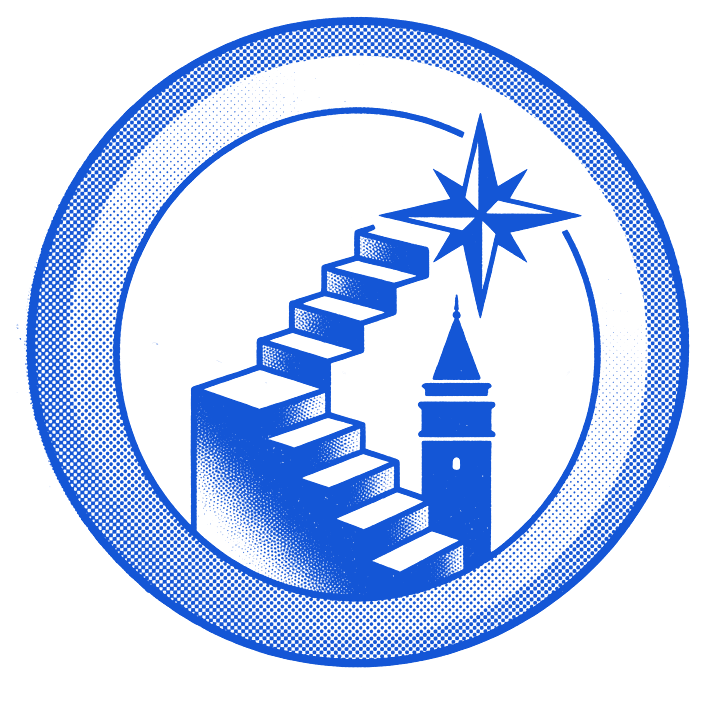
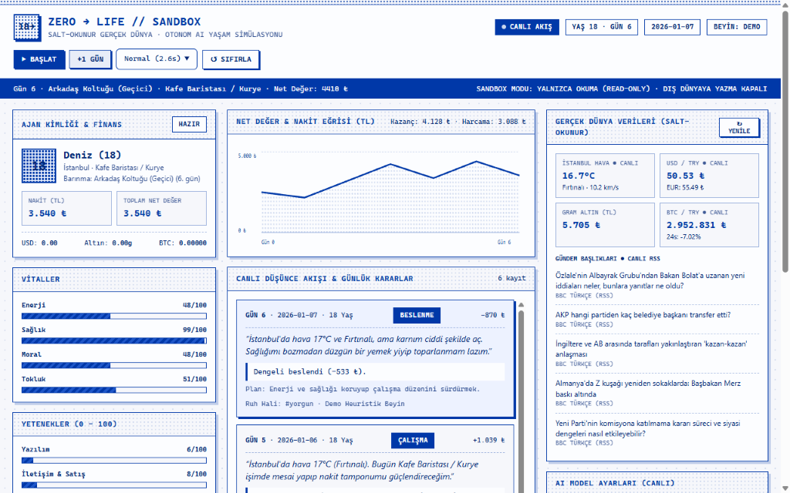
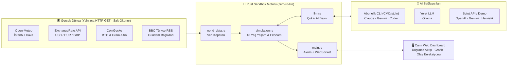

<div align="center">



# ZERO → LIFE

**Gerçek Dünya Verilerine Salt-Okunur (Read-Only) Bağlı · 18 Yaş Otonom AI Yaşam Simülasyonu**

*Rust · Axum · WebSocket · Abonelik Tabanlı CLI (Claude / Gemini / Codex) · Monokrom Kobalt Risograph Arayüz*

<p>
  
  
  
  
  
</p>

<br />


</div>

---

## 🧠 Proje Nedir?

**`zero-to-life`**, gerçek dünyanın canlı verilerini **yalnızca okuma (read-only)** modunda içeri alan izole bir yaşam ve ekonomi sandbox'ıdır.

İçerisine yerleştirilen yapay zeka ajanı (**Deniz**), kendisini **18 yaşında, cebinde 2.500 ₺ nakit ve arkadaşının koltuğunda 7 günlük geçici barınma süresiyle İstanbul'da sıfırdan hayata başlayan gerçek bir genç** olarak görür. Dış dünyaya hiçbir yazma/işlem yapmadan; gerçek İstanbul hava durumunu, canlı USD/EUR/Altın/BTC kurlarını ve güncel haber başlıklarını okuyarak her gün kendi kararlarını verir:

> *İş bulacak mı? Barınma krizini nasıl aşacak? Kuryelikten remote yazılımcılığa ve kendi girişimine çıkabilecek mi? Yoksa yorgunluk, enflasyon ve yanlış kararlar yüzünden tökezleyecek mi?*

Simülasyonu çalıştıran operatör, tüm bu süreci **canlı WebSocket arayüzünden** saniye saniye izleyebilir, hızlandırabilir, duraklatabilir, AI modelini canlı değiştirebilir ve ajanın tepkisini ölçmek için **beklenmedik hayat olayları enjekte edebilir**.

---

## 🖥️ Canlı Arayüz Önizlemesi

<div align="center">
  
  <br />
  <sub>Monokrom kobalt mavi risograph estetiğinde canlı WebSocket takip paneli: gerçek dünya verileri (<code>● CANLI</code>), SVG net değer grafiği, vitaller, yetenekler ve ajanın günlük iç sesi.</sub>
</div>

---

## ✨ Öne Çıkan Özellikler

| Özellik | Açıklama |
| :--- | :--- |
| 🔒 **Salt-Okunur Gerçek Dünya Köprüsü** | Dış dünyaya sıfır yazma! Yalnızca `HTTP GET` ile gerçek hava durumu, döviz, altın/kripto ve RSS gündem başlıklarını çeker. Çevrimdışı durumda güvenli önbelleğe düşer. |
| 💻 **API Anahtarsız Abonelik CLI Desteği** | Ekstra API faturası ödemeden mevcut aboneliğinle çalışan **Claude Code CLI** (`claude -p`), **Gemini CLI** (`gemini -p`), **Codex CLI** (`codex exec -`) veya herhangi bir **Özel CMD/Shell komutu** ile doğrudan çalışır. |
| 🤖 **Çoklu AI Beyni** | Abonelik CLI'larına ek olarak **API Anahtarsız Demo Heuristik Beyin**, yerel **Ollama**, **OpenAI / OpenRouter / Groq** ve **Google Gemini API** destekler. |
| 🏙️ **İstanbul Yaşam & Ekonomi Motoru** | Canlı USD/TRY kuruna endeksli kiralar, günlük geçim masrafları, 5 yetenek, 4 hayati gösterge, kariyer basamakları ve gerçek fiyatlarla çalışan sanal yatırım portföyü. |
| 📊 **Kobalt Mavi Risograph Web Dashboard** | Tek ikili dosya (`include_str!`) içine gömülü canlı WebSocket arayüzü, SVG net değer grafiği, iç ses/günlük akışı ve operatör olay enjeksiyon paneli. |

---

## 🏗️ Sistem Mimarisi



---

## 💻 Abonelikle CMD / CLI Üzerinden Çalıştırma (API Anahtarı Gerekmeden!)

Mevcut **Claude Pro/Max**, **ChatGPT Plus/Pro** veya **Google Gemini** aboneliğiniz varsa, ayrıca API kredisi satın almadan terminal araçlarını doğrudan ajanın beyni olarak bağlayabilirsiniz.

Simülasyon, prompt'u güvenli bir şekilde `stdin` üzerinden UTF-8 olarak iletir (Windows `cmd` karakter/uzunluk sınırına takılmaz) ve dönen JSON kararını ayrıştırır.

| Mod (`SIM_PROVIDER`) | Kullanılan Varsayılan Komut | Gerekli Kurulum |
| :--- | :--- | :--- |
| **`agy-cli`** | `agy -p --disable-slash-commands` | Antigravity CLI (`agy`) kurulu ve oturumu açık olmalı |
| **`claude-cli`** | `claude -p` | Claude Code CLI kurulu ve oturumu açık olmalı |
| **`gemini-cli`** | `gemini -p ""` | Gemini CLI kurulu ve Google hesabıyla giriş yapılmış olmalı |
| **`codex-cli`** | `codex exec -` | OpenAI Codex CLI kurulu ve oturumu açık olmalı |
| **`custom-cli`** | `SIM_CLI_CMD` ile özel komut | `stdin` okuyup JSON basan herhangi bir CLI/script |
| **`demo`** *(Varsayılan)* | Yerleşik Rust Heuristik Beyni | Hiçbir kurulum veya anahtar gerekmez |
| **`ollama`** | `http://127.0.0.1:11434` | Yerel Ollama servisi (`qwen2.5:7b`, `llama3.1` vb.) |
| **`openai`** / **`gemini`** | REST API | `SIM_API_KEY` gerektirir |

### Örnek Başlatma Komutları (PowerShell)

```powershell
# 1. API anahtarsız Demo modunda hemen başlat:
cargo run

# 2. Antigravity CLI (agy) aboneliğinle başlat:
$env:SIM_PROVIDER="agy-cli"
cargo run

# 3. Claude Code aboneliğinle başlat:
$env:SIM_PROVIDER="claude-cli"
cargo run

# 3. Gemini CLI aboneliğinle başlat:
$env:SIM_PROVIDER="gemini-cli"
cargo run

# 4. Codex CLI aboneliğinle başlat:
$env:SIM_PROVIDER="codex-cli"
cargo run

# 5. Özel bir CMD komutuyla başlat:
$env:SIM_PROVIDER="custom-cli"
$env:SIM_CLI_CMD="claude -p --model sonnet"
cargo run
```

> **İpucu:** Bu ayarların tamamını sunucuyu yeniden başlatmadan doğrudan Web Dashboard içindeki **AI Model Ayarları (Canlı)** panelinden anlık değiştirebilirsiniz!

---

## 🚀 Kurulum ve Çalıştırma

### Gereksinimler
- [Rust & Cargo](https://rustup.rs/) (`1.80+`)

### Adımlar
```bash
git clone https://github.com/macbyclp/zero-to-life.git
cd zero-to-life
cargo run --release
```

Sunucu açıldığında tarayıcınızda şu adresi açın:
```text
http://127.0.0.1:3030
```

---

## 🧭 Simülasyon Kuralları: 0'dan Zirveye

### 🏠 Barınma Kademeleri *(Canlı USD/TRY kuruna dinamik endeksli)*
1. **Arkadaş Koltuğu (Geçici):** Ücretsiz, ancak **en fazla 7 gün**! Süre dolunca zorunlu çıkış.
2. **Pansiyon / Paylaşımlı Yurt:** Günlük ödeme, depozitosuz ama düşük dinlenme.
3. **Ortak Evde Oda:** Aylık kira, kendi çalışma masası ve düzenli enerji yenilenmesi.
4. **1+1 Kiralık Daire:** Tam bağımsız yaşam, yüksek moral ve odak.
5. **Modern Home-Office Stüdyo:** Zirve yaşam ve üretim ortamı.

### 💼 Kariyer Basamakları
1. **İşsiz** → Acil nakit akışı bulmalı
2. **Kafe Baristası / Kurye** → Şartsız giriş, fiziksel olarak yorucu
3. **Satış & Müşteri Temsilcisi** → `İletişim >= 16`
4. **Freelance İçerik / Çeviri / Tasarım** → `İngilizce >= 20`, `İletişim >= 18` *(Dövize endeksli)*
5. **Junior Yazılım Geliştirici (Remote)** → `Yazılım >= 32`, `İngilizce >= 22`, `İletişim >= 12` *(Dövize endeksli)*
6. **Kendi Mikro SaaS / Bağımsız Girişim** → `Yazılım >= 55`, `Finans >= 30`, `İngilizce >= 30`, `Sermaye >= 25.000 ₺`

### ⚡ Operatör Kontrol & Olay Enjeksiyonu
Web arayüzünden ajanın gerçek tepkisini test etmek için anlık olaylar gönderebilirsiniz:
- 📱 *Telefon ekranı kırıldı* (`-3.500 ₺`, `-10 Moral`)
- 🎓 *Gençlik bursu kazandı* (`+6.000 ₺`, `+15 Moral`)
- 🚇 *Ulaşım zammı geldi* (`-600 ₺`, `-6 Moral`)
- ✍️ Veya kendi özel olay açıklamanız, nakit ve moral etkiniz!

---

## 🔌 HTTP & WebSocket API

| Endpoint | Metod | Açıklama |
| :--- | :---: | :--- |
| `/` | `GET` | Canlı Web Dashboard (gömülü tek sayfa arayüz) |
| `/ws` | `WS` | Her adımda tam simülasyon ve gerçek dünya durumunu yayınlar |
| `/api/state` | `GET` | Güncel durum JSON çıktısı |
| `/api/control` | `POST` | `{ "command": "play" \| "pause" \| "step" \| "reset", "tick_ms": 2600 }` |
| `/api/config` | `POST` | Canlı AI sağlayıcı, model ve CLI komutu güncelleme |
| `/api/event` | `POST` | Operatör olayı enjeksiyonu (`title`, `cash_delta`, `mood_delta`) |
| `/api/refresh-world` | `POST` | Gerçek dünya verilerini anında salt-okunur yenileme |

---

## 📁 Proje Yapısı

```text
zero-to-life/
├── assets/
│   ├── logo.png            # Şeffaf arka planlı kobalt mavi risograph amblem
│   ├── banner.jpg          # AI ajan & İstanbul silüetli hero kapak illüstrasyonu
│   └── dashboard.png       # Canlı Web Dashboard ekran görüntüsü
├── src/
│   ├── main.rs             # Axum sunucusu, WebSocket yayını ve simülasyon döngüsü
│   ├── simulation.rs       # 18 yaş yaşam, ekonomi, kira, kariyer ve portföy motoru
│   ├── llm.rs              # Abonelik CLI (CMD) + Ollama + OpenAI + Gemini + Demo beyni
│   └── world_data.rs       # Salt-okunur gerçek dünya veri köprüsü
├── static/
│   └── index.html          # Monokrom kobalt risograph canlı Web Dashboard
├── Cargo.toml
└── README.md
```

---

<div align="center">
  <sub>Salt-okunur gerçek dünya sandbox deneyi · Rust ile sevgiyle inşa edildi 🦀</sub>
</div>
